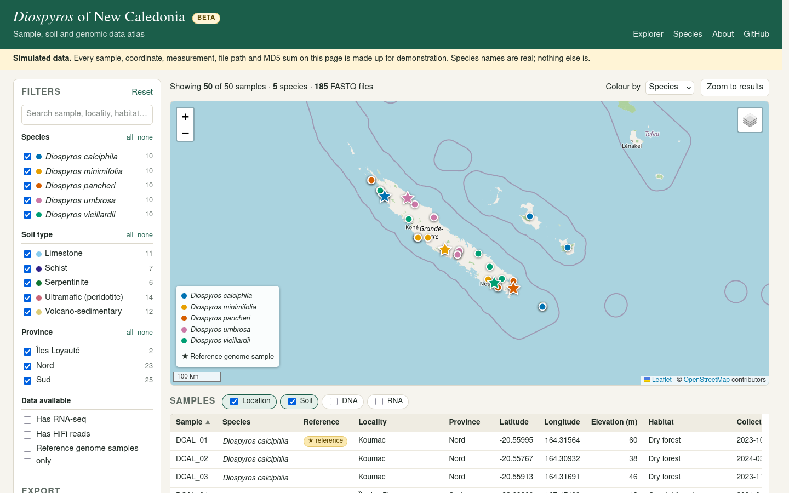

# *Diospyros* of New Caledonia: sample atlas

An interactive map and data browser for *Diospyros* (Ebenaceae) samples in New Caledonia, made for a PhD project at the University of Vienna.

**Live site:** <https://amnghn.github.io/Diospyros-NC-Atlas/> (beta version)



> [!IMPORTANT]
> **All data in this repository are simulated.** The species names are real. Every sample, coordinate, measurement, file path and MD5 sum is made up by `scripts/simulate_data.py`. The data exist only to design and test the site, and they must not be used for research. The real data are not public.

## Contents

- [Features](#features)
- [Run the site locally](#run-the-site-locally)
- [Data](#data)
- [Checks](#checks)
- [Keeping real data out of this repository](#keeping-real-data-out-of-this-repository)
- [Deployment](#deployment)
- [Repository layout](#repository-layout)
- [Versions and changes](#versions-and-changes)
- [How to cite](#how-to-cite)
- [Licence](#licence)
- [AI declaration](#ai-declaration)
- [Report a problem or suggest an improvement](#report-a-problem-or-suggest-an-improvement)

## Features

- A map of all samples, with three base maps (street, topographic and satellite). The reference sample of each genome assembly is drawn as a star.
- Filters by species, soil type, province, data availability (RNA-seq, HiFi reads, reference samples) and free text.
- Colouring of the map by species or by soil type, with colourblind-safe palettes (Okabe & Ito for species, Paul Tol's "muted" palette for soil types).
- A sample table, sortable by any column. Groups of columns (location, soil, DNA, RNA) can be switched on and off.
- Export of the filtered samples, or of the FASTQ paths and MD5 sums of the filtered samples, as CSV or TSV.
- A detail panel for each sample, with all its data and its sequencing files.
- Species cards with a photo, the assembly statistics and a link to the reference sample.
- Keyboard use: sortable column headers are buttons, table rows open with Enter or Space, and Escape closes the detail panel.
- An About page with the author, contact, citation, licence, disclaimer and AI declaration, and a 404 page.

## Run the site locally

The site is static: there is no build step and no server-side code. The data are loaded with `fetch()`, so the site must be served over HTTP. Opening `index.html` directly from disk does not work.

```bash
python3 -m http.server 8000
```

Then open <http://localhost:8000/>.

To test the site under the same sub-path as on GitHub Pages (`/Diospyros-NC-Atlas/`), serve it through a symbolic link. The folder `.preview/` is ignored by git.

```bash
mkdir -p .preview
ln -s .. .preview/Diospyros-NC-Atlas
python3 -m http.server 8765 --bind 127.0.0.1 --directory .preview
```

Then open <http://localhost:8765/Diospyros-NC-Atlas/>. On a remote machine, forward port 8765 to your computer (for example in the *Ports* panel of VS Code Remote-SSH). Stop the server with Ctrl+C.

## Data

The site reads three tab-separated files in `data/`:

| File | One row per | Main columns |
| --- | --- | --- |
| `species.tsv` | species (5) | `species_id`, `species`, `color`, `reference_sample_id`, assembly name, path, MD5 and statistics, `photo`, `photo_credit` |
| `samples.tsv` | sample (50) | `sample_id`, `species_id`, `is_reference`, date, locality, province, `latitude`, `longitude`, elevation, habitat, soil, DNA and RNA columns |
| `files.tsv` | FASTQ file (185) | `sample_id`, `species_id`, `data_type` (DNA or RNA), `platform` (Illumina or PacBio HiFi), `read`, `path`, `size_gb`, `md5` |

[`data/README.md`](data/README.md) describes every column with its unit, the file format and the rules the data must follow. The species photos are placeholder drawings in `assets/photos/`.

New soil types, provinces or species appear in the filters automatically. To show other columns in the table, edit `COLUMN_GROUPS` and `LABELS` at the top of `js/app.js`, and add the columns to `scripts/check_data.py`.

### Regenerate the simulated data

```bash
python3 scripts/simulate_data.py
```

The script uses only the Python standard library and a fixed random seed (42). It writes exactly the same bytes every time; this was tested with Python 3.9, 3.10, 3.11, 3.12, 3.13 and 3.14.

## Checks

| Command | What it checks | Where it runs |
| --- | --- | --- |
| `python3 scripts/check_data.py` | Columns, cell counts, unique IDs, links between the tables, exactly one reference sample per species with a HiFi file, MD5 format, coordinates inside New Caledonia, photo paths | locally and in the workflow |
| `python3 scripts/check_site.py` | Relative paths, published files, integrity hashes, the hidden email address, the Beta badge and version on every page, the same version in `js/version.js`, `CITATION.cff` and `CHANGELOG.md` | locally and in the workflow |
| `bash scripts/check_reproducible.sh` | The reproducibility guard (see below) | locally and in the workflow |
| `node scripts/browser_check.mjs …` | Every page, filter, export, the detail panel, the About page and the 404 page in headless Firefox | locally only |

The workflow uses Python 3.12. On LiSC, run the Python checks with `python3.12`; the guard chooses `python3.12` by itself when it is available.

The browser check needs Node 22 or newer and Firefox, and a running preview server (see above). On LiSC, Firefox is only available on the login node, and Node is loaded as a module:

```bash
module load nodejs/22.17.1-GCCcore-14.3.0
node scripts/browser_check.mjs --url http://127.0.0.1:8765/Diospyros-NC-Atlas/ --width 1440 --out <output folder>
node scripts/browser_check.mjs --url http://127.0.0.1:8765/Diospyros-NC-Atlas/ --width 375 --out <output folder>
```

It writes screenshots, the downloaded exports and a report into the output folder. Options: `--og <file>` saves the 1200 × 630 px preview image used for link previews (`assets/og-image.png`), and `--screenshot <file>` saves the screenshot shown above (`docs/screenshot.png`).

## Keeping real data out of this repository

- Only the output of `scripts/simulate_data.py` may be committed in `data/` and `assets/photos/` (plus `data/README.md`).
- The **reproducibility guard** (`scripts/check_reproducible.sh`) proves this, on LiSC and in every workflow run. It re-runs the simulator and fails if `git diff --exit-code -- data assets/photos` shows a difference, if the simulator writes files that are not committed, or if a file that is not on its allowlist is committed in these folders. It also fails if any tracked file is larger than 5 MB. It refuses to run when these folders have uncommitted changes, so that it never overwrites local files.
- `.gitignore` blocks places where real data might be put by mistake, so that git cannot commit them:
  - `private/`, `data/real/` and `data_private/`: folders for private data;
  - `*.private.tsv`, `*.private.csv` and any `*.private.*` file;
  - raw sequencing and assembly files (`*.fastq`, `*.fastq.gz`, `*.fq.gz`, `*.bam`, `*.cram`, `*.vcf.gz`, `*.fasta.gz`, `*.fa.gz`), which are also far too large for a repository;
  - local tools and previews (`.preview/`, `_site/`, `.venv-*/`, `.tools/`).

  These rules are a safety net. Real data should not be stored in this folder at all.
- Before every commit: run `git status`, check that only the expected files are staged, and never commit files larger than 5 MB.

## Deployment

The site is published on GitHub Pages by the GitHub Actions workflow [`.github/workflows/pages.yml`](.github/workflows/pages.yml). It runs on every push to `main`, and by hand from the *Actions* tab.

1. The **check** job sets up Python 3.12 and runs `check_data.py`, `check_site.py` and the reproducibility guard.
2. The **deploy** job runs only if all checks pass. It copies exactly the paths listed in [`scripts/site_files.txt`](scripts/site_files.txt) (`index.html`, `about.html`, `404.html`, `favicon.svg`, `LICENSE`, `css/`, `js/`, `data/`, `assets/`) into `_site/` and publishes them with the official actions `configure-pages`, `upload-pages-artifact` and `deploy-pages`. `scripts/`, `docs/` and `.github/` are never published.

In the repository settings, *Settings → Pages → Build and deployment → Source* must be set to *GitHub Actions*.

All links in the pages are relative, so the site works under the sub-path `/Diospyros-NC-Atlas/`. The one exception is `404.html`: GitHub Pages shows it for every missing address, also in sub-folders, so it sets `<base href="/Diospyros-NC-Atlas/">`. If the repository is renamed, change this line and the addresses in the Open Graph tags, `js/site.js` and `CITATION.cff`.

## Repository layout

```
index.html                 map page: filters, map, sample table, detail panel, species cards
about.html                 About page
404.html                   "Page not found" page
favicon.svg                site icon
css/style.css              styles
js/app.js                  map page logic (loads data/*.tsv; Leaflet 1.9.4 from unpkg with integrity hashes)
js/site.js                 shared by all pages: GitHub link (REPO_URL), version, contact email
js/version.js              version and date of the last change (the only place the pages read them from)
data/                      simulated data (species.tsv, samples.tsv, files.tsv) and their description (README.md)
assets/photos/             placeholder drawings of the species (written by the simulator)
assets/og-image.png        preview image for link previews
scripts/simulate_data.py   writes the simulated data and drawings
scripts/check_data.py      data checks
scripts/check_site.py      site checks
scripts/check_reproducible.sh  reproducibility guard
scripts/browser_check.mjs  headless browser check (local only)
scripts/site_files.txt     list of published files
docs/PROMPT.md             the prompts used to build the site
docs/screenshot.png        screenshot for this README
.github/workflows/pages.yml    check and deploy workflow
.github/ISSUE_TEMPLATE/    issue templates (bug report, suggestion)
CHANGELOG.md               record of all changes
CITATION.cff               citation metadata
LICENSE                    MIT licence
```

## Versions and changes

The project uses [semantic versioning](https://semver.org/) with a `-beta` suffix. The current version is **0.1.0-beta**. The pages read the version and the date of the last change from `js/version.js`. When the version changes, update `js/version.js`, `CITATION.cff` and `CHANGELOG.md` together; `scripts/check_site.py` fails if they differ. Every change is recorded, with a timestamp, in [`CHANGELOG.md`](CHANGELOG.md).

## How to cite

> Ghane, A. (2026). *Diospyros* of New Caledonia: sample atlas (version 0.1.0-beta) [website and source code]. <https://github.com/amnghn/Diospyros-NC-Atlas>

The citation metadata are in [`CITATION.cff`](CITATION.cff); GitHub shows them under *Cite this repository*.

## Licence

The whole repository, code and site text, is released under the [MIT licence](LICENSE). The real data and the species photographs, when they are added later, will have their own terms.

The site uses [Leaflet](https://leafletjs.com) (BSD 2-Clause licence) and map tiles from OpenStreetMap (map data © [OpenStreetMap contributors](https://www.openstreetmap.org/copyright), ODbL), [OpenTopoMap](https://opentopomap.org) (CC-BY-SA) and Esri World Imagery (source: Esri, Vantor, Earthstar Geographics, and the GIS User Community; [Esri terms of use](https://goto.arcgisonline.com/maps/World_Imagery)).

## AI declaration

This website was developed with the help of Claude Code (Anthropic), an AI coding assistant. The author designed the website, wrote the instructions, reviewed the code and the text, and checked the results. The prompts used to build it are in [`docs/PROMPT.md`](docs/PROMPT.md). A record of all changes is in [`CHANGELOG.md`](CHANGELOG.md).

## Report a problem or suggest an improvement

Suggestions and bug reports are welcome. Please open an issue on [GitHub Issues](https://github.com/amnghn/Diospyros-NC-Atlas/issues) (templates: *Bug report*, *Suggestion*), or write to aminghane [at] univie.ac.at.

**Author:** Amin Ghane, PhD student in Ecology and Evolution, Department of Botany and Biodiversity Research, University of Vienna; member of the [Plant Ecological Genomics](https://plantgenomics.univie.ac.at/index.php?id=26086&L=0) research group led by Ovidiu Paun. ORCID: [0000-0002-1035-8650](https://orcid.org/0000-0002-1035-8650).
